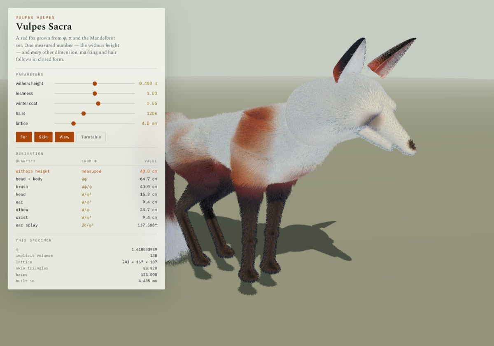
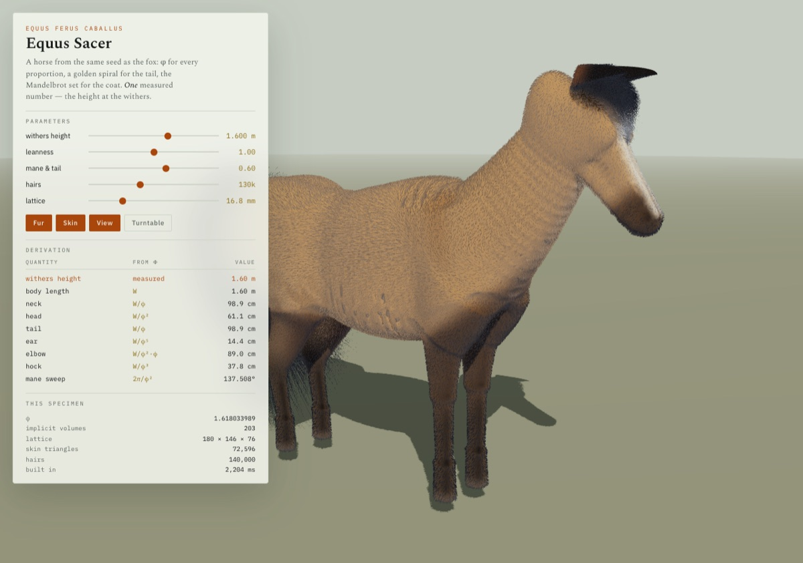

# Vulpes Sacra

### A controlled A/B test in procedural morphogenesis: anatomy vs sacred geometry

**Same renderer. Same tissue fields. Same fur. The only variable is how the body is proportioned.**

[Play the standalone demo](demo/vulpes-standalone.html) · [Read the manual](manual.html) · [Rig notes](RIG.md) · [License](LICENSE)





## What this is

Vulpes Sacra is a Three.js research harness for generating creature bodies from code. It compares two construction systems on the same species:

- **A — Anatomy / allometry.** Adult red-fox scale anchors, a canid-like axial skeleton, digitigrade limb landmarks, separate tissue fields, and functional joint constraints. Natural asymmetry is applied only after the bilateral scaffold exists.
- **B — Sacred geometry.** Withers height sets scale; body, head, and tail lengths come from powers and partitions of φ; joint heights use φ partitions; tail spacing uses Fibonacci/golden partitions; ear offsets and tail curvature use the golden angle. B deliberately does **not** blend back toward empirical fox proportions — that is what makes the A/B meaningful.

Both modes share the marching-cubes skin generator, tissue and muscle-volume emitters, facial/ear/paw detail, fur-line generation, lighting, camera, and fox-likeness critic. The harness also includes other species (Equus, Homo, Mammut, Balaena, Chelonia, Rana, Salmo, Psittacus, Vultur, Phoenicopterus) so the same rules can be inspected across body plans.

This is a research prototype, not a finished game. The interesting part is the comparison, the parameter surface, and the fact that every mesh is generated at runtime.

## Run it

The root app needs a local web server because it uses ES modules:

```bash
python3 -m http.server 8080
# open http://localhost:8080
```

Or open `demo/vulpes-standalone.html` directly — it is a self-contained build with Three.js bundled.

No build step and no package install are required for the root app; Three.js is vendored in `vendor/`.

## Controls

- **A / B** — switch between anatomy and sacred geometry.
- **Species tabs** — apply the same A/B logic to another body plan.
- **Body / leg / head / ear / tail / muscle / coat / asymmetry** — change the shared phenotype.
- **Skeleton + tissue** — inspect the underlying scaffold.
- **Toggle fur** — show or hide the generated fur lines.
- **Auto rotate / Reset** — orbit the model or restore defaults.
- Mouse drag orbits; wheel zooms.

## What is procedural

Every creature mesh, tissue field, coat pattern, and fur line is generated from the code in `src/`. The rendered images in `docs/renders/` were produced by this harness. No downloaded character models or scanned textures are included.

## Status and limits

- The A/B is a design experiment, not a validated biological model.
- The fox-likeness critic is a heuristic, not a ground truth.
- The sacred-geometry mode is intentionally non-empirical; it is not trying to be a fox.
- Performance depends on the marching-cubes resolution and the number of fur lines.

## License

- **Code:** MIT — see [LICENSE](LICENSE).
- **Rendered images:** CC BY 4.0 — see [ASSET-LICENSE.md](ASSET-LICENSE.md).
- **Third-party:** Three.js and its examples are MIT — see [THIRD_PARTY.md](THIRD_PARTY.md).

## Credits

Built by Andreas Xirtus. Three.js by the Three.js authors. The harness was developed as an experiment in procedural anatomy and AI-assisted construction; the design decisions, constraints, and A/B methodology are the point.
